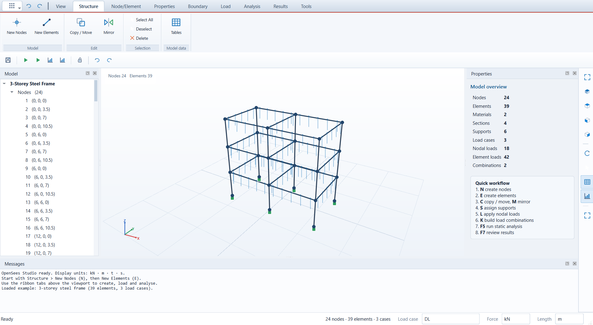
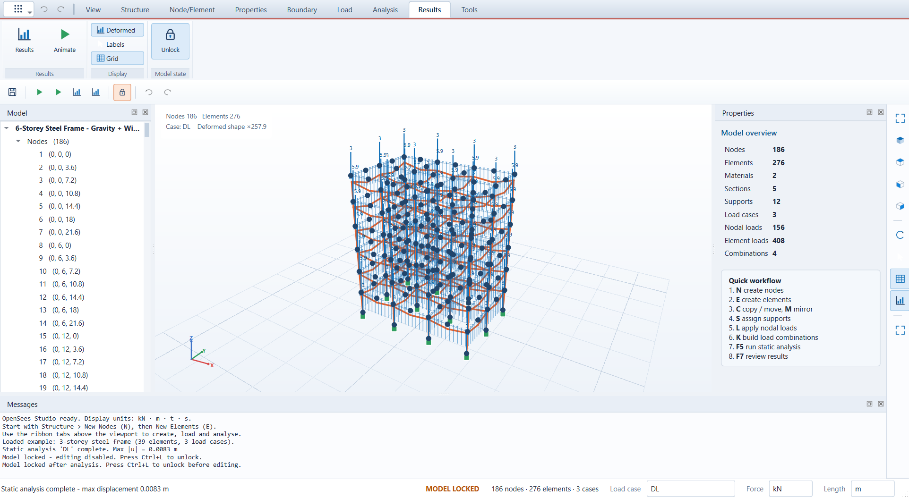
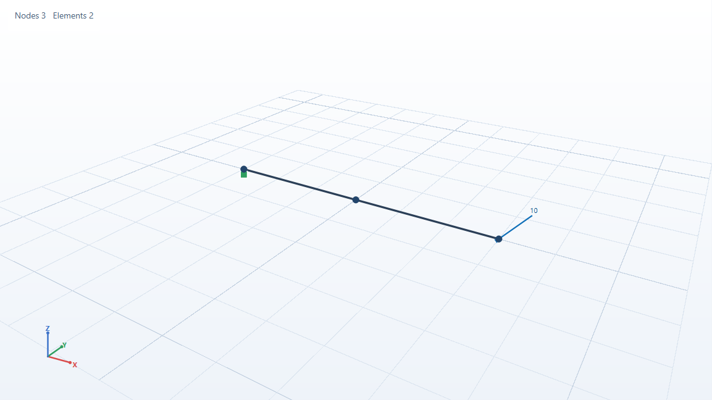

# OpenSees Studio

A graphical model generator for **OpenSees**, built with Python,
PySide6 and OpenSeesPy. It focuses on the model-generation workflow: nodes, elements,
copy/move/mirror, supports, load cases, nodal and element loads, self weight,
load combinations, static and modal analysis, and result review. The interface uses a
ribbon with task tabs, command groups and group captions.



## Units

The model is stored and solved in **kN, mm, tonne, s**. The default display units are
**kN and m**. The status bar at the bottom right has two selectors that change the units
used for input, tables and results without changing the stored model:

- **Force:** kN, N, kip, lbs
- **Length:** m, mm, in, ft

Moments, stresses, densities, section properties and distributed loads follow from the chosen
pair (for example moment in kN·m, stress in N/m², distributed load in kN/m). Project files,
Tcl export and the MCP server always use the base units below, so switching the display units
never changes the analysis.

| Quantity | Base unit |
|---|---|
| Length | mm |
| Force | kN |
| Moment | kN·mm |
| Stress / E | kN/mm² (1 kN/mm² = 1000 MPa) |
| Density | t/mm³ (steel 7.85e-9) |
| Distributed load | kN/mm (10 kN/m = 0.01 kN/mm) |

Self weight is computed as `ρ · A · g` with `g = 9806.65 mm/s²`.

## Features

**Interface**
- Ribbon tabs (View, Structure, Node/Element, Properties, Boundary, Load, Analysis,
  Results, Tools) with command groups and captions.
- Quick horizontal command strip (save, run, results, check, lock, undo/redo) and a
  vertical view strip (fit, iso, top, front, right, orbit, labels, grid, deformed).
- Model, Properties and Messages panels can be collapsed and restored from
  **View > Panels**.

**Structure**
- Create nodes by coordinates, with repetition and spacing.
- Create beams (`elasticBeamColumn`), trusses and 4-node shells (`ShellMITC4`).
- Chain creation: give a list of nodes and beams/trusses are created between consecutive nodes.
- Copy / move with a translation and repeat count; attached elements are duplicated.
- Mirror about the XY, XZ or YZ plane, with or without keeping the original.
- Supports: fixed, pinned, roller Z, or any combination of 6 DOF.
- Material library: Elastic, ElasticPP, Steel02, Concrete02.
- Section library with automatic properties for rectangle, circle, pipe, box and I-shape;
  user sections can supply A, Iy, Iz, J directly.
- Model tree lists nodes, elements, materials, sections, supports, load cases, loads
  and combinations.
- Spreadsheet **Tables** editor for every entity, with validation.

**Loads**
- Load cases (Dead, Live, Wind, Seismic, …), each becomes an OpenSees pattern.
- Nodal forces and moments on selected nodes, a single node, or all nodes.
- Element loads: uniform, trapezoidal (approximated by point loads) and point loads,
  in local y/z or global X/Y/Z directions, with automatic local-axis conversion.
- Self weight per load case with a factor.
- Load combinations with per-case factors.
- Active load case selector in the status bar; loads are drawn for the active case.

**Analysis and results**
- Static analysis (`LoadControl`, `BandGen`, RCM, Linear).
- Modal analysis (eigenvalues, periods, frequencies, animated mode shapes).
- Model check (`F9`) for missing references, zero-length elements, unconnected nodes,
  missing supports and missing loads.
- Result viewer: displacements, reactions, element forces (N, Vy, Vz, T, My, Mz at both ends),
  modal periods; CSV export.
- Finished analyses switch to the **Results** ribbon tab instead of opening a dialog.
- The model locks automatically after an analysis; press **Ctrl+L** or use the lock
  button to unlock for editing. Results clear when the model is changed.
- Deformed shape overlay with automatic scale.



**AI integration**
- MCP server (43 tools) so AI agents can build models, run analyses and read
  results; optional live GUI bridge with screenshots.

**Project**
- Save / open `.ospj` JSON projects.
- Export an OpenSees Tcl input file.
- Undo / redo (100 steps).
- Built-in 3-storey steel frame example.

## Keyboard shortcuts

| Key | Action |
|---|---|
| N | New nodes |
| E | New elements |
| C | Copy / move |
| M | Mirror |
| S | Supports |
| L | Nodal loads |
| K | Load combinations |
| T | Tables |
| F5 / F6 | Run static / modal |
| F7 | Results |
| F9 | Model check |
| F | Fit view |
| O | 3D orbit mode (left-drag rotates) |
| Ctrl+L | Lock / unlock model editing |
| Ctrl+Z / Ctrl+Y | Undo / redo |
| Del | Delete selection |

**Mouse:** left = select (drag = box select), middle = pan, right = orbit, wheel = zoom.
Press **O** (or the Orbit ribbon button) for AutoCAD-style orbit mode, where left-drag rotates
the model; Shift+left-drag or Shift+middle-drag always orbits. Ctrl adds to the selection.

## MCP server (AI agents)

`mcp_server/` exposes OpenSees Studio to AI agents over the **Model Context
Protocol** (stdio transport, 43 tools). Agents can build the whole model,
run analyses and read results.

**Tools** (grouped): project new/open/save/summary, node creation (single,
list, line), element creation (beam/truss/shell chains), copy/move/mirror/delete,
supports, material and section libraries, load cases, nodal loads, element
loads, self weight, load combinations, model check, static analysis, modal
analysis, displacements/reactions/forces, mode shapes, Tcl export, and GUI
control (`gui_launch`, `gui_connect`, `gui_sync`, `gui_screenshot`,
`gui_show_results`).

### Run it

From source (development):

```powershell
.\.venv\Scripts\python.exe -m mcp_server
```

Installed application:

```
%LOCALAPPDATA%\Programs\OpenSees Studio\mcp\OpenSeesStudioMCP.exe
```

The server speaks MCP on stdio, so it is normally started by the AI client,
not by hand.

### Client configuration

OpenCode (`opencode.json`):

```json
{
  "mcp": {
    "opensees-studio": {
      "type": "local",
      "command": ["C:\\Users\\<you>\\AppData\\Local\\Programs\\OpenSees Studio\\mcp\\OpenSeesStudioMCP.exe"],
      "enabled": true
    }
  }
}
```

Claude Desktop / other clients using the `mcpServers` schema:

```json
{
  "mcpServers": {
    "opensees-studio": {
      "command": "C:\\Users\\<you>\\AppData\\Local\\Programs\\OpenSees Studio\\mcp\\OpenSeesStudioMCP.exe",
      "args": []
    }
  }
}
```

To use the Python module instead:

```json
{
  "mcpServers": {
    "opensees-studio": {
      "command": "C:\\path\\to\\OpenSeesStudio\\.venv\\Scripts\\python.exe",
      "args": ["-m", "mcp_server"],
      "cwd": "C:\\path\\to\\OpenSeesStudio"
    }
  }
}
```

### Live GUI control

Start the application with the bridge enabled:

```powershell
OpenSeesStudio.exe --bridge 8765
```

Then the agent calls `gui_launch` (starts the app itself) or `gui_connect`
(default port 8765). Every model change is mirrored into the running window,
results are drawn as deformed shapes / mode animations, and `gui_screenshot`
returns the viewport as an image.



The bridge binds to `127.0.0.1` only and has no authentication; do not expose
the port to untrusted networks.

### Verification

```powershell
.\.venv\Scripts\python.exe tests\test_mcp.py        # protocol + full workflow
.\.venv\Scripts\python.exe tests\test_mcp_gui.py    # live GUI bridge
```

## Development

```powershell
py -3.12 -m venv .venv
.\.venv\Scripts\python.exe -m pip install -r requirements.txt
.\.venv\Scripts\python.exe -m app.main
```

Tests (closed-form verification + GUI workflows):

```powershell
.\.venv\Scripts\python.exe tests\test_solver.py
.\.venv\Scripts\python.exe tests\test_gui.py
```

Headless self test (also available in the frozen exe):

```powershell
.\.venv\Scripts\python.exe -m app.main --selftest --report report.txt
```

## Packaging

```powershell
.\build.ps1
```

The script renders the icon, runs PyInstaller for both the application and the
MCP server, executes all tests (including the frozen MCP server), and compiles the
Inno Setup installer. Outputs:

- `dist\OpenSeesStudio\OpenSeesStudio.exe` – portable application folder
- `dist\OpenSeesStudioMCP\OpenSeesStudioMCP.exe` – MCP server (stdio)
- `dist\OpenSeesStudio-1.0.0-Setup.exe` – Windows installer with Start Menu and
  optional desktop shortcut

## Project layout

```
app/
  main.py         entry point, self test, screenshot mode
  mainwindow.py   ribbon, docks, workflows
  ribbon.py       ribbon tabs, command groups and captions
  viewport.py     3D viewport: camera, picking, loads, deformed shapes
  model.py        data model and JSON persistence
  units.py        display-unit conversion and unit labels
  opsgen.py       OpenSees model builder, analyses, Tcl export, validation
  dialogs.py      node / element / copy / load / combination dialogs
  tables.py       spreadsheet model tables
  results.py      result viewer and CSV export
  example.py      built-in demo frame
  theme.py        light professional theme
  icons.py        vector ribbon icons
  bridge.py       local JSON bridge for live GUI control
mcp_server/
  server.py       MCP tools, state, resources
  gui.py          client for the GUI bridge
tests/            solver, GUI and MCP tests
tools/            icon renderer, screenshot generator
packaging/        Inno Setup script and MCP config sample
```
