<div align="center">

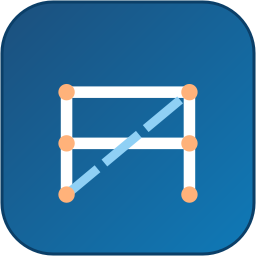

# OpenSees Studio

**Modern 3D graphical modeler, structural analysis GUI, and AI-ready MCP server for OpenSees**

[](https://github.com/sumonrh/OpenSeesStudio/releases/tag/v1.0.24-alpha)
[](https://github.com/sumonrh/OpenSeesStudio/releases/tag/v1.0.24-alpha)
[](https://www.python.org/)
[-41cd52?logo=qt&logoColor=white)](https://doc.qt.io/qtforpython-6/)
[](#mcp-server-ai-agents)
[](LICENSE.txt)

[Download Installer](#-install-on-windows) · [Gallery](#-visual-tour) · [Bridge Live Load](#-bridge-live-load) · [Design Tools](#-design-calculators) · [MCP Server](#mcp-server-ai-agents) · [Development](#-development)

<br />

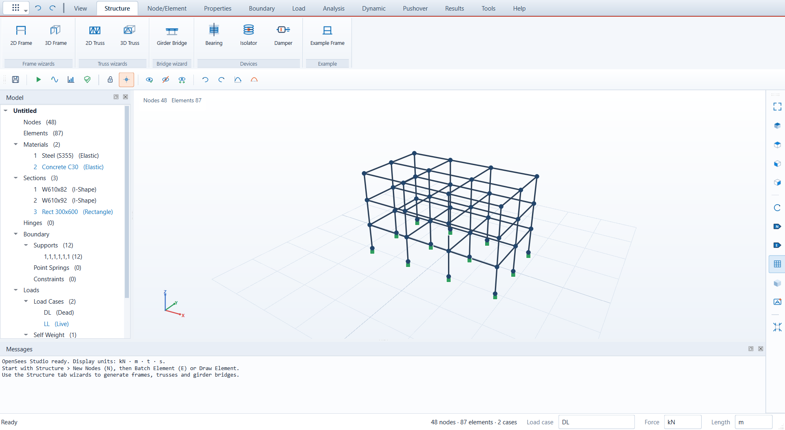

</div>

> [!WARNING]
> **Research & educational use only (Early Alpha).** OpenSees Studio is under active development and results are **not fully verified**. Do not use it for commercial engineering work, structural design decisions, or any application involving public safety. Independently verify all outputs before use. See [`DISCLAIMER.md`](DISCLAIMER.md).

> [!NOTE]
> **Latest release: `v1.0.24-alpha`** — Adds extruded section rendering for 2D/3D trusses, a dedicated **Reactions** panel (`Rx/Ry/Rz/Rxy/Rxz/Ryz/Rxyz` and `Mx/My/Mz/Mxy/Mxz/Myz/Mxyz`) with world-scaled arrows, preserved static + modal results tables, clean modal view overlays, persistent **Structure/Boundary Groups**, and live-load envelope display over the MCP GUI bridge.
> [**Download `OpenSeesStudio-1.0.24-alpha-Setup.exe`**](https://github.com/sumonrh/OpenSeesStudio/releases/tag/v1.0.24-alpha)

---

## Overview

**OpenSees Studio** wraps **OpenSeesPy** in a fast, desktop-native engineering workspace built with Python and PySide6. It covers the full finite-element workflow in one interface:

- **3D Modeling & Wizards:** Ribbon-driven interface with 2D/3D Frame, 2D/3D Truss, and Multi-Span Girder Bridge wizards, AISC/CISC steel section libraries, custom cross-sections, nonlinear fibre frames, bearings/isolators/dampers, point springs, constraints, and persistent Structure/Boundary Groups.
- **Comprehensive Analysis:** Static, modal (animated mode shapes), displacement-controlled nonlinear pushover with lumped/fibre plastic hinges, dynamic time history (with PEER AT2 ground-motion catalog), response spectrum (SRSS/CQC), and bridge moving-truck live-load envelopes.
- **Interactive Post-Processing:** Filled beam force diagrams (`Fx, Vy, Vz, Mx, My, Mz`), world-scaled support reaction arrows with directional filtering, deformed shapes, and unified static + modal results tables with CSV export.
- **AI Agent Ready (MCP):** Ships a 96-tool **Model Context Protocol** server (`OpenSeesStudioMCP.exe`) with a live GUI bridge so AI assistants can construct models, run analyses, inspect results, and capture viewport screenshots.

---

## Visual Tour

### Analysis & Post-Processing

| Beam Force Diagrams (`My`, `Mz`, `Vy`, `Vz`, `Fx`, `Mx`) | Support Reaction Diagrams (`Rx–Rxyz`, `Mx–Mxyz`) |
| :---: | :---: |
| 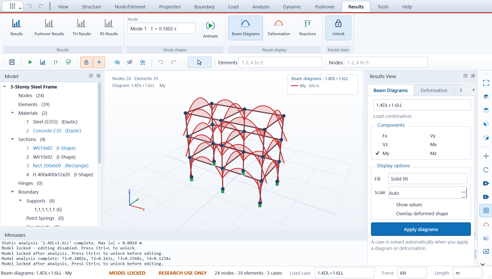 | 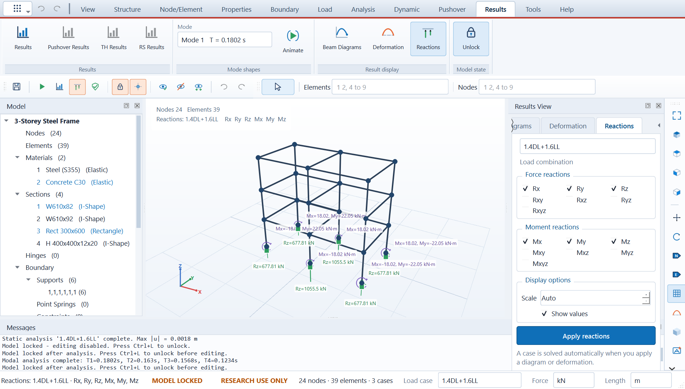 |
| **Deformed Shape Overlay** | **Unified Static + Modal Results Table** |
| 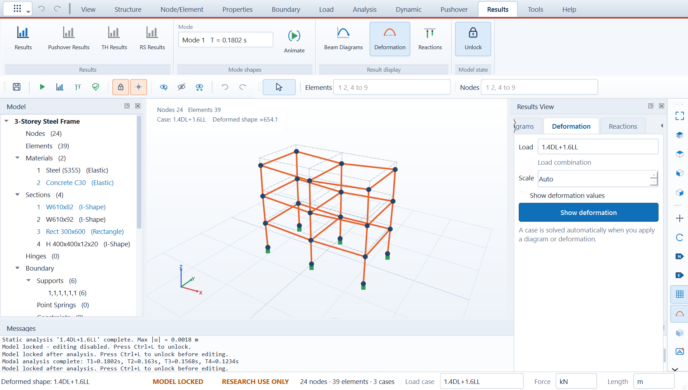 | 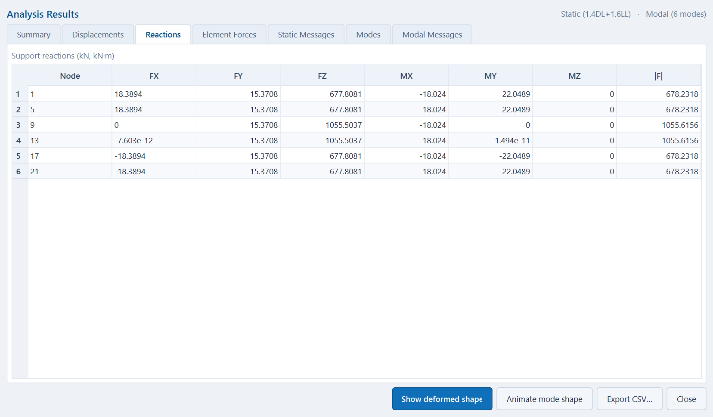 |

### 3D Modeling, Wizards & Extruded Sections

| Extruded 3D Space Truss | Multi-Span Girder Bridge Grillage |
| :---: | :---: |
| 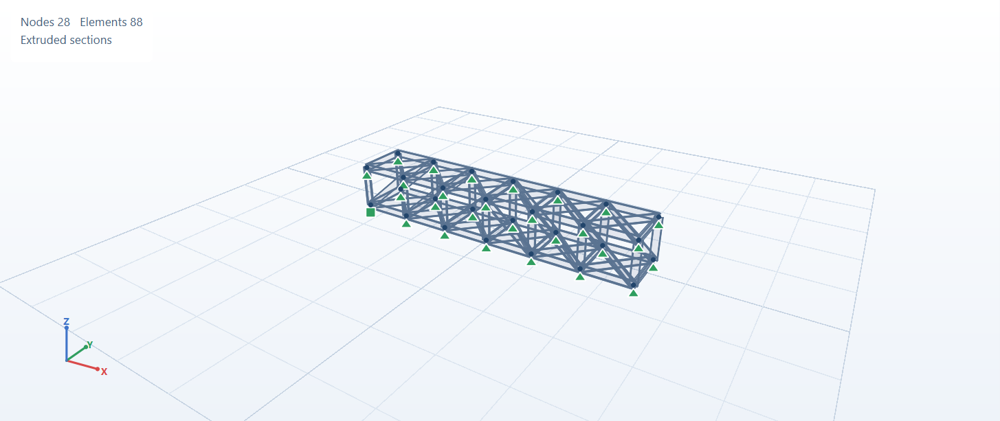 | 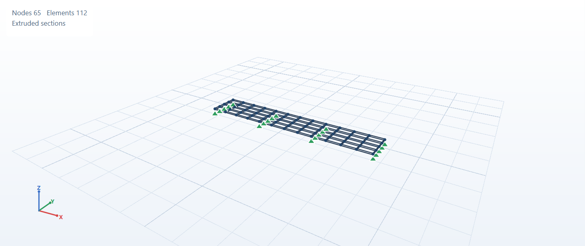 |
| **3D Moment Frame Wizard** | **AISC & CISC Standard Section Library** |
| 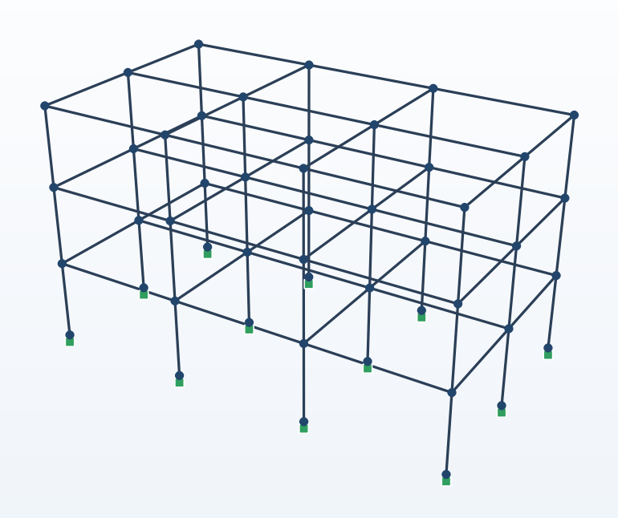 | 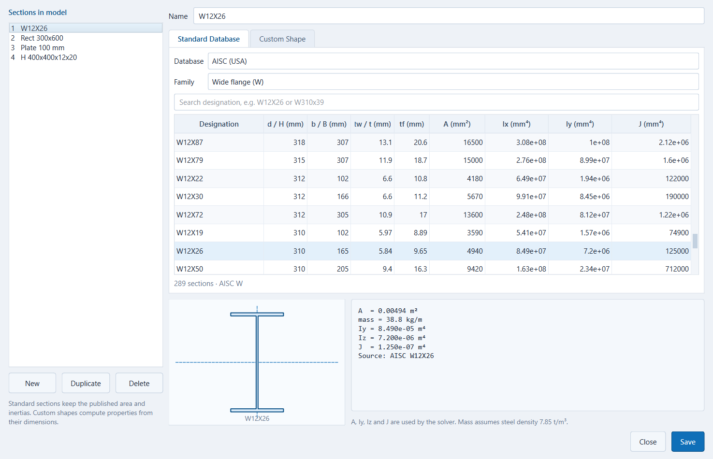 |

---

## Install on Windows

[**Download the latest alpha installer (`v1.0.24-alpha`)**](https://github.com/sumonrh/OpenSeesStudio/releases/tag/v1.0.24-alpha)

1. Open the release link above and download **`OpenSeesStudio-1.0.24-alpha-Setup.exe`** under **Assets** (not the source archives).
2. Run the downloaded installer from your **Downloads** folder.
3. If Windows SmartScreen displays *"Windows protected your PC"*, click **More info → Run anyway** (alpha builds are not yet code-signed).
4. Follow the installer wizard and launch **OpenSees Studio** from the Start menu or desktop shortcut.

- **Requirements:** Windows 10 or 11 (64-bit). No Python installation or administrator password required — installs per-user into `%LOCALAPPDATA%\Programs\OpenSees Studio`.
- **Includes MCP Server:** `%LOCALAPPDATA%\Programs\OpenSees Studio\mcp\OpenSeesStudioMCP.exe` — see [MCP server](#mcp-server-ai-agents).
- **Uninstall:** **Settings → Apps → Installed apps → OpenSees Studio → Uninstall** or Start menu uninstaller.

---

## Design Calculators

| Section Property Pro (`Tools > Section Properties`) | Moment Curvature Pro (`Tools > Moment Curvature`) |
| :---: | :---: |
| 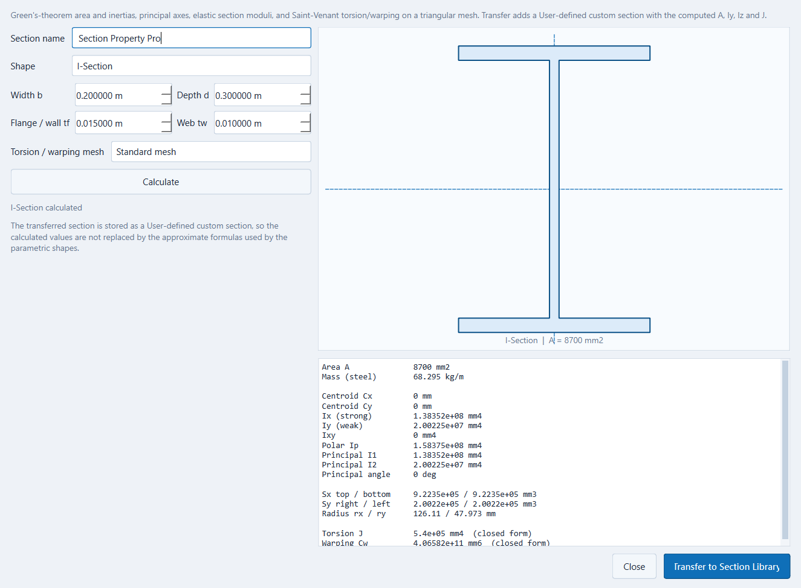 |  |

- **Section Property Pro:** Computes area, centroid, strong/weak/principal inertias, section moduli, radii of gyration, Saint-Venant torsion constant `J`, and warping constant `Cw` for I, T, C, L, rectangular, hollow box, open-top box, circle, pipe, hexagon, octagon, double-angle, double-channel, and octagon-with-hole sections using Green's theorem + triangular Saint-Venant FEM. **Transfer to Section Library** saves both properties and 3D extrusion outline.
- **Moment Curvature Pro:** Fibre-section Mander (confined/unconfined concrete) + Park (rebar) analysis for rectangular and circular RC columns/beams. Reports yield/peak/ultimate moments, curvature ductility, plastic hinge length, and idealises a trilinear **`MomentBackbone`** hinge definition for pushover and nonlinear time-history `zeroLength` springs.

<details>
<summary>View idealised moment-rotation backbone screenshot</summary>

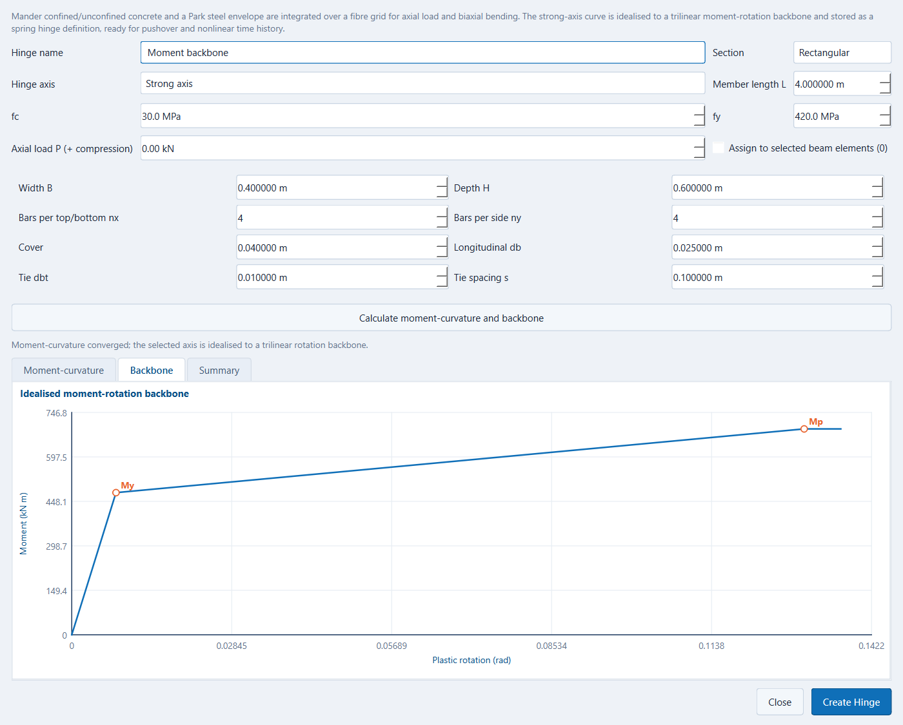

</details>

---

## Bridge Live Load

OpenSees has no native moving-truck or influence-line engine. OpenSees Studio includes a dedicated **Bridge Live-Load Analyzer** built on a continuous Euler-Bernoulli beam influence-line solver:

| Moving-Truck & Lane Envelopes | Influence Lines |
| :---: | :---: |
| 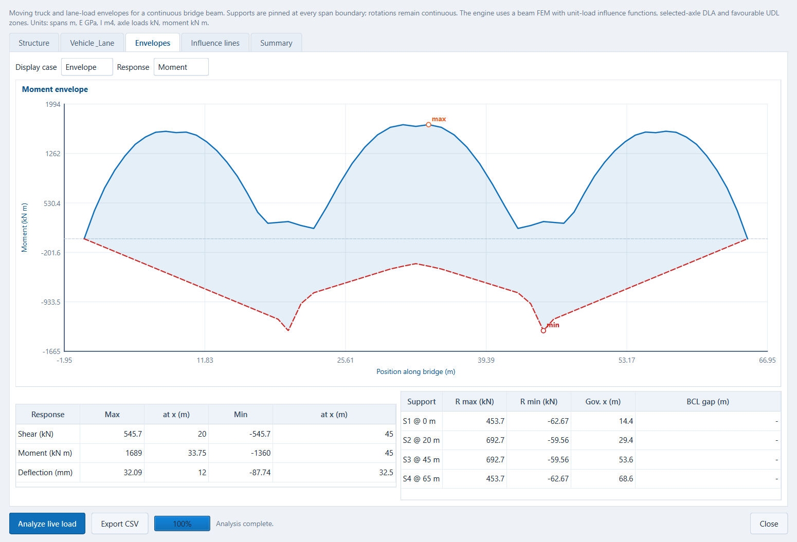 | 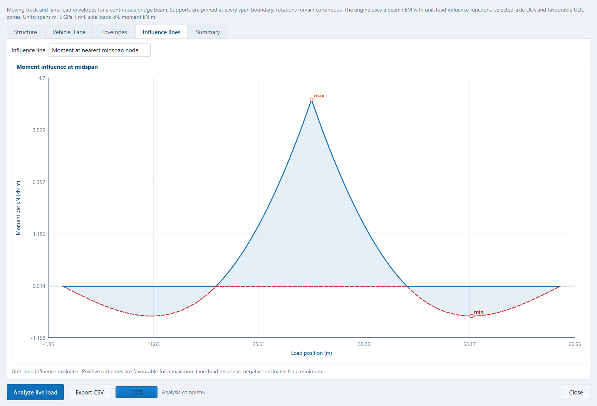 |

- **Model-driven:** Automatically reads support locations, span lengths, and mean `E`/`I` from any selected continuous beam chain in the 3D model.
- **Vehicles & Lanes (`Load` tab):** Built-in **CL-625**, **BCL-625** (variable 6.6–18 m axle 3–4 spacing), and custom 1–20 axle vehicles; straight or curved traffic lanes with lateral wheel-line offset; auto selected-axle DLA (40/30/25%) with manual override and `d` multiplier; bi-directional truck sweeps.
- **Viewport Envelopes:** Generates **LL Max**, **LL Min**, and **LL All** result cases with simultaneous moment (`My`) and shear (`Vz`) envelopes rendered directly along the 3D bridge chain.

---

## Feature Highlights

### Interface & Viewport
- **Ribbon UI** with task tabs (`View`, `Structure`, `Node/Element`, `Properties`, `Boundary`, `Load`, `Analysis`, `Dynamic`, `Pushover`, `Results`, `Tools`, `Help`).
- **Customizable Toolbars:** Quick horizontal strip (save, run, results, reactions, check, lock, visibility, undo/redo), selection strip with range parsing (`1, 4 to 9`), and vertical view strip (fit, iso/top/front/right, pan, orbit, labels, grid, deformed, extruded, clean view).
- **Persistent Groups Dock:** Create, rename, and recall **Structure Groups** (elements) and **Boundary Groups** (nodes).
- **Extruded 3D View:** Renders beams, columns, and 2D/3D trusses with true cross-section geometry.
- **Spreadsheet Tables & Drag-and-Drop:** Excel-compatible `Ctrl+C` / `Ctrl+V` model tables for every entity; drag materials, sections, or hinges directly from the Model tree onto selected elements.

### Modeling & Libraries
- **Wizards:** 2D/3D Frame, 2D/3D Truss, and Multi-Span Girder Bridge grillage.
- **Elements:** `elasticBeamColumn`, `forceBeamColumn` & `dispBeamColumn` (fibre sections, Lobatto/Legendre/NewtonCotes/Radau integration), standard/tension-only/compression-only trusses, `corotTruss` cables, `ShellMITC4` shells, `elastomericBearingBoucWen` bearings, `LeadRubberX` isolators, and `ViscousDamper`/`BilinearOilDamper` links.
- **Boundary & Springs:** 6-DOF supports, `zeroLength` Elastic / `MultiLinear` / `PySimple1` point springs (standard, tension-only, compression-only), `rigidLink`, `equalDOF`, and `rigidDiaphragm`.
- **Sections & Materials:** Full **AISC (USA)** and **CISC (Canada)** steel catalogs, custom parametric shapes, and `Elastic`, `ElasticPP`, `Steel02`, `Concrete02` materials (plus 20 OpenSees uniaxial/moment-rotation hinge families).
- Full inventory and roadmap: [`docs/OPENSEES_TYPES.md`](docs/OPENSEES_TYPES.md) · [`docs/ANALYSIS_ROADMAP.md`](docs/ANALYSIS_ROADMAP.md).

### Analysis & Post-Processing
- **Isolated Solver Process:** OpenSees runs in a dedicated child process with live progress and Cancel support so solver crashes never close the GUI.
- **Analysis Types:** Static (`LoadControl`), Modal (animated mode shapes + mode selector), Nonlinear Pushover (`beamWithHinges` / rotational spring hinges), Dynamic Time History (ground-motion catalog, PEER AT2 / 1-col / 2-col, Rayleigh damping, step slider), Response Spectrum (SRSS/CQC), and Bridge Live Load.
- **Preserved Multi-Analysis Results:** Running static and modal analyses preserves both in the **Analysis Results** table (`Summary`, `Displacements`, `Reactions`, `Element Forces`, `Modes`, and logs) with CSV export; viewing mode shapes automatically clears static/reaction overlays for a clean animation.
- **Model Lock & Validation:** Model check (`F9`) catches orphan nodes, zero-length elements, and missing supports/loads; models auto-lock after analysis (`Ctrl+L` to unlock).

---

## Units

Internal storage, solver execution, `.ospj` files, Tcl export, and the MCP server always use consistent base units (**kN, mm, tonne, s**). Display units default to **kN and m** and can be switched live from the status bar (**Force:** `kN, N, kip, lbs` · **Length:** `m, mm, in, ft`) without altering the model.

| Quantity | Base Unit | Notes |
| --- | --- | --- |
| Length | `mm` | Self weight `ρ · A · g` with `g = 9806.65 mm/s²` |
| Force | `kN` | — |
| Moment | `kN·mm` | Displayed in selected force × length unit |
| Stress / `E` | `kN/mm²` | `1 kN/mm² = 1000 MPa` |
| Density | `t/mm³` | Steel `7.85e-9 t/mm³` |
| Distributed load | `kN/mm` | `10 kN/m = 0.01 kN/mm` |

---

## Keyboard Shortcuts & Navigation

| Key | Action | Key | Action |
| --- | --- | --- | --- |
| `N` / `E` | New nodes / Batch elements | `F5` / `F6` | Run Analysis Control / Modal |
| `C` / `M` | Copy-Move / Mirror | `F7` / `F9` | Results table / Model check |
| `S` / `L` / `K` | Supports / Nodal loads / Combos | `F` / `O` / `P` | Fit view / Orbit mode / Pan mode |
| `T` | Model Tables | `Ctrl+L` | Lock / unlock model editing |
| `Ctrl+A` / `Del` | Select visible / Delete | `Ctrl+Z` / `Ctrl+Y` | Undo / Redo (100 steps) |

**Mouse:** Left = select (drag = box select, `Ctrl` = add), Middle = pan, Right = orbit, Wheel = zoom. `Shift+Left` always orbits.

---

## MCP Server (AI Agents)

`mcp_server/` exposes **96 tools** over the **Model Context Protocol** (stdio transport), enabling AI coding agents (Antigravity, Claude Desktop, OpenCode, Cursor, etc.) to build models, assign materials/sections/hinges, run static/modal/pushover/time-history/response-spectrum/live-load analyses, import/export Tcl, and drive the live GUI.

### Client Configuration (`mcpServers` JSON)

```json
{
  "mcpServers": {
    "opensees-studio": {
      "command": "C:\\Users\\<you>\\AppData\\Local\\Programs\\OpenSees Studio\\mcp\\OpenSeesStudioMCP.exe",
      "args": []
    }
  }
}
```

<details>
<summary>OpenCode & Python-source MCP configuration examples</summary>

**OpenCode (`opencode.json`):**
```json
{
  "mcp": {
    "opensees-studio": {
      "type": "local",
      "command": ["C:\\Users\\<you>\\AppData\\Local\\Programs\\OpenSees Studio\\mcp\\OpenSeesStudioMCP.exe"],
      "enabled": true
    }
  }
}
```

**From Python source:**
```json
{
  "mcpServers": {
    "opensees-studio": {
      "command": "C:\\path\\to\\OpenSeesStudio\\.venv\\Scripts\\python.exe",
      "args": ["-m", "mcp_server"],
      "cwd": "C:\\path\\to\\OpenSeesStudio"
    }
  }
}
```

</details>

### Live GUI Bridge

Launch the desktop app with `--bridge` (or let the agent call `gui_launch` directly):

```powershell
OpenSeesStudio.exe --bridge 8765
```

Every model edit, static/modal solve, and bridge live-load envelope can be mirrored live into the viewport (`gui_sync`, `gui_show_results`, `gui_show_diagram`, `gui_show_live_load`, `gui_screenshot`). The bridge binds strictly to `127.0.0.1`.

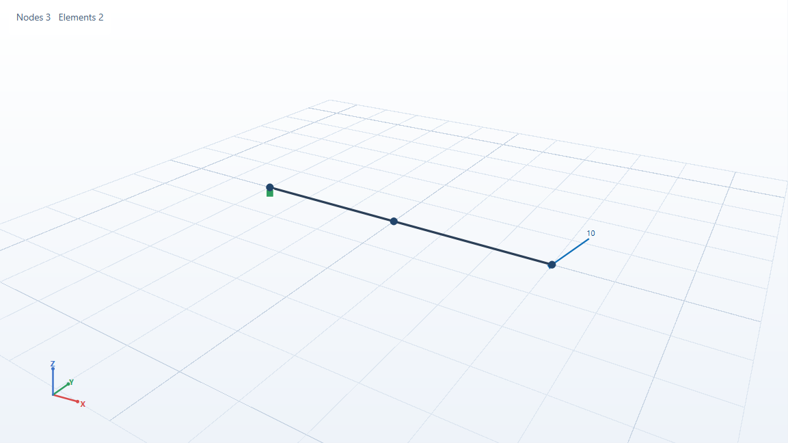

---

## Script Console & Tcl Import

- **Tools > Script Console:** Run **Python (OpenSeesPy)** or **Tcl** commands directly in the shared OpenSees domain, capture generated geometry/loads in metres or millimetres, and load them into Studio (or export the current model as Tcl in one click).
- **File > Import Tcl:** Imports nodes, supports, uniaxial/nD materials, `PlateFiber` sections, `geomTransf`, beam/truss/`ShellMITC4` elements, and load patterns.

---

## Development & Packaging

```powershell
# Setup & run from source
py -3.12 -m venv .venv
.\.venv\Scripts\python.exe -m pip install -r requirements.txt
.\.venv\Scripts\python.exe -m app.main

# Run verification suites
.\.venv\Scripts\python.exe tests\test_solver.py
.\.venv\Scripts\python.exe tests\test_gui.py
.\.venv\Scripts\python.exe tests\test_mcp.py
.\.venv\Scripts\python.exe tests\test_mcp_gui.py

# Build portable exes + Windows installer (runs all tests & frozen self-test)
.\build.ps1
```

<details>
<summary>Code signing & Project layout</summary>

### Optional Code Signing
Set `$env:OSS_SIGN_PFX` (with optional `$env:OSS_SIGN_PASSWORD`) or `$env:OSS_SIGN_THUMBPRINT` before running `.\build.ps1` to SHA-256 timestamp-sign both executables and `dist\OpenSeesStudio-1.0.24-alpha-Setup.exe`.

### Project Layout
```text
app/            PySide6 GUI, 3D viewport, wizards, calculators, OpenSeesPy engine, GUI bridge
mcp_server/     96-tool MCP stdio server & GUI bridge client
tests/          Closed-form solver verification, GUI workflows, MCP & bridge tests
tools/          Icon renderer and screenshot capture utilities
packaging/      Inno Setup installer script and MCP client config example
docs/           Screenshots, OpenSees element inventory, analysis roadmap
```

</details>

---

## License

OpenSees Studio is **source-available, not OSI open source**. Original code is licensed under the **PolyForm Noncommercial License 1.0.0** ([`LICENSE.txt`](LICENSE.txt)) — free to use, modify, and share for noncommercial purposes; commercial use and selling are not permitted.

The Windows installer bundles **OpenSees** and **OpenSeesPy** (UC Regents OpenSees license; not covered by PolyForm — commercial distribution requires a separate license from UC Berkeley / OpenSeesPy maintainers) and **Qt / PySide6** (LGPL-3.0). OpenSees Studio is an independent project and is not affiliated with or endorsed by UC Berkeley, OpenSees, or OpenSeesPy. See [`NOTICE.md`](NOTICE.md), [`DISCLAIMER.md`](DISCLAIMER.md), [`THIRD_PARTY_NOTICES.md`](THIRD_PARTY_NOTICES.md), [`CONTRIBUTING.md`](CONTRIBUTING.md), and [`licenses/`](licenses/).
